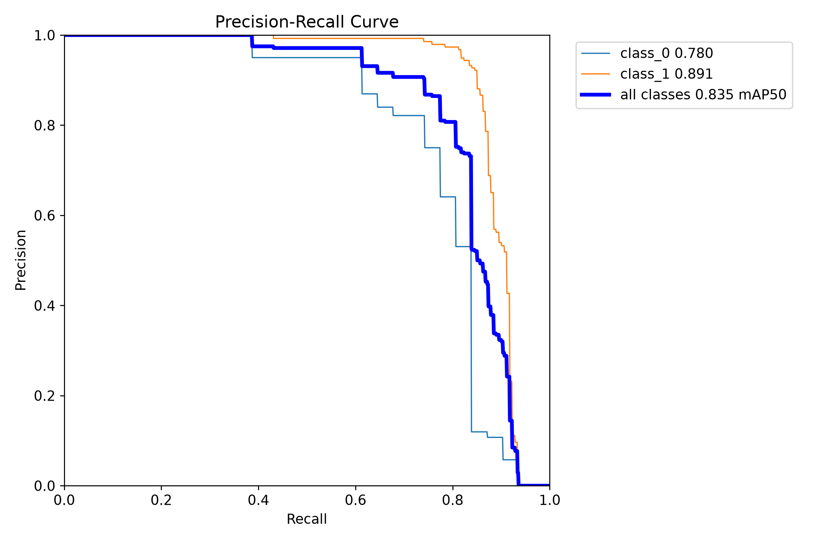
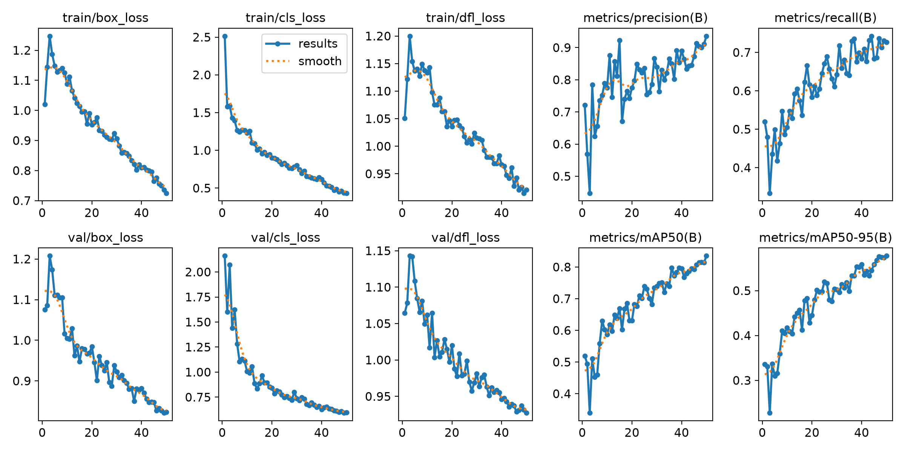
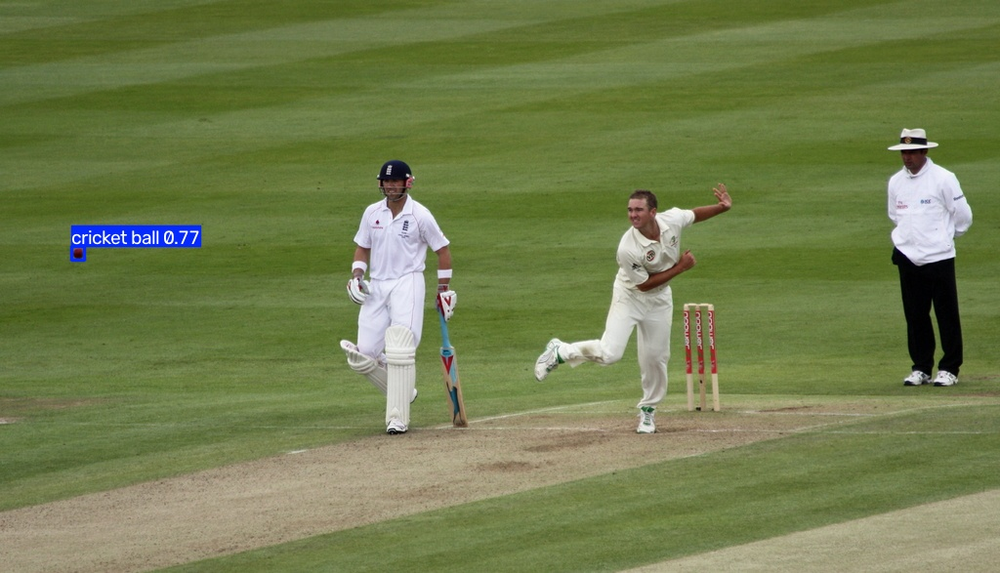
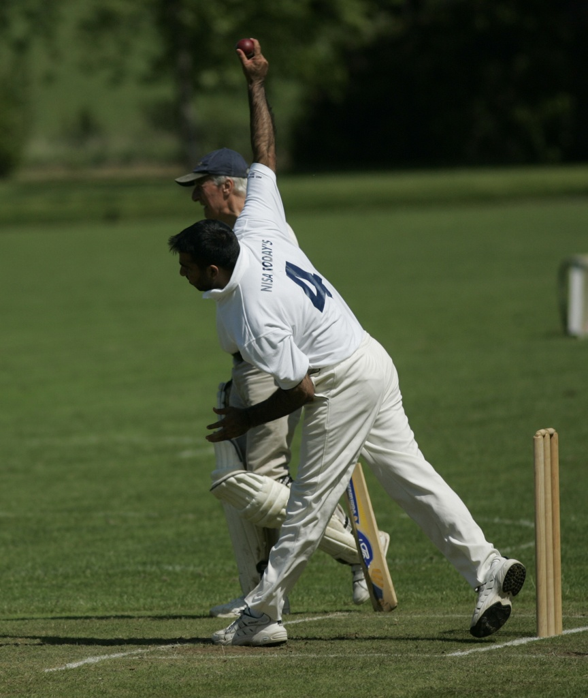
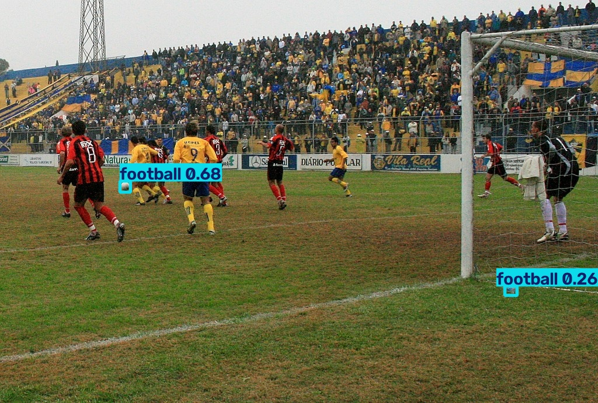
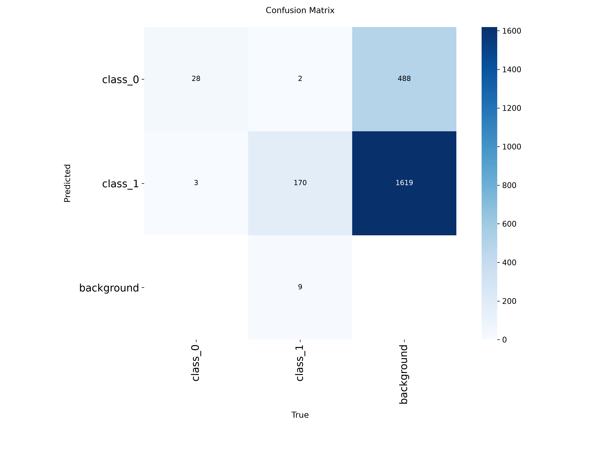

# 크리켓공과 축구공 객체 탐지 결과 보고서

경기 사진 속 공의 위치를 찾고, 크리켓공과 축구공을 구분하는 모델을 만들었다. 이미지 전체에 종목 이름을 붙이는 분류 작업이 아니라, 공 하나하나에 바운딩 박스와 클래스 이름을 표시하는 객체 탐지 작업이다.

YOLO11n 사전학습 모델을 50 epoch 동안 학습한 결과, 검증 데이터에서 **mAP@50 83.52%, mAP@50–95 57.75%**를 기록했다. 작은 공을 찾아내는 사례를 확인했지만 크리켓공을 놓치거나 배경을 공으로 표시하는 사례도 남아 있었다. 기본적인 탐지 모델을 구축했다는 데 의미가 있으며, 다양한 경기 환경에서 안정적으로 사용할 수 있는지는 추가 검증이 필요하다.

이 보고서는 저장된 학습 로그, 데이터 검사 결과, 평가 그래프와 예측 이미지를 바탕으로 작성했다. 보고서 작성을 위해 별도의 학습이나 재평가를 실행하지는 않았다.

## 1. 데이터 구성

학습용 이미지 679장과 검증용 이미지 190장을 사용했다. 이미지마다 같은 이름의 TXT 라벨이 연결되어 있다. 한 이미지에 여러 개의 공이 포함될 수 있으므로 이미지 수와 객체 수는 다르다.

| 구분 | 이미지 | 라벨 파일 | 크리켓공 객체 | 축구공 객체 | 전체 객체 |
|---|---:|---:|---:|---:|---:|
| 학습 | 679 | 679 | 111 | 685 | 796 |
| 검증 | 190 | 190 | 31 | 181 | 212 |
| 합계 | 869 | 869 | 142 | 866 | 1,008 |

클래스 ID는 **0이 `cricket ball`, 1이 `football`**이다. 라벨은 `class_id x_center y_center width height` 순서의 YOLO 형식이며, 좌표와 크기는 이미지 크기에 대해 정규화되어 있다.

학습 데이터에서 축구공은 크리켓공보다 약 6.2배 많다. 따라서 전체 평균 성능만으로 두 종류의 공을 모두 잘 찾는다고 판단하기 어렵다. 특히 크리켓공의 검증 객체는 31개뿐이어서 소수의 성공이나 실패에도 평가 결과가 영향을 받을 수 있다.

데이터 검사에서는 이미지 읽기 오류, 이미지·라벨 짝 불일치, 잘못된 클래스 ID, 좌표 범위 오류가 발견되지 않았다. 빈 라벨과 학습·검증 폴더 사이의 동일 파일명도 없었다. 다만 이는 파일 구조와 형식에 대한 검사다. 사람이 표시한 박스의 정확성이나 다른 이름으로 저장된 유사 이미지까지 확인한 것은 아니다.

## 2. 학습 방법

기존 YOLO 형식의 데이터를 그대로 사용해 YOLO11n을 미세 조정했다. 데이터 검사, 학습, 예측은 `main.py`의 개별 명령으로 실행하도록 구성했다.

| 항목 | 이번 실험의 설정 |
|---|---|
| 초기 모델 | `yolo11n.pt`, 사전학습 가중치 사용 |
| 학습 횟수 | 50 epoch |
| 입력 이미지 크기 설정 | 640 |
| 배치 크기 | 8 |
| 장치 설정 | GPU 0 (`device: "0"`) |
| 데이터 로더 worker | 0 |
| 시드 | 42 |
| 옵티마이저 설정 | `auto` |
| 혼합 정밀도 설정 | AMP 활성화 |
| 주요 증강 설정 | 좌우 반전, 이동·크기·색상 변화, Mosaic |
| Mosaic 종료 설정 | 마지막 10 epoch에서 종료 |

위 내용은 `runs/ball_detection/args.yaml`을 기준으로 정리했다. 옵티마이저는 자동 선택 설정이므로, 설정 파일의 학습률 값만으로 실제 선택된 옵티마이저를 단정하지 않았다. GPU 모델명과 처리 속도 벤치마크도 이번 보고서에서 확인한 자료에는 포함되지 않는다.

학습 로그의 마지막 누적 시간은 **713.802초, 약 11분 54초**였다. 이는 CSV에 기록된 학습 진행 시간이며, 환경 설치나 가중치 다운로드까지 포함한 전체 작업 시간은 아니다.

## 3. 검증 결과

### 전체 성능

다음 수치는 `results.csv`의 첫 번째와 마지막 epoch를 비교한 것이다. 기록된 50개 epoch 중 mAP@50–95가 가장 높은 시점도 마지막인 50 epoch였다.

| 지표 | 1 epoch | 50 epoch |
|---|---:|---:|
| Precision | 72.09% | **93.58%** |
| Recall | 51.95% | **72.65%** |
| mAP@50 | 51.94% | **83.52%** |
| mAP@50–95 | 33.58% | **57.75%** |

Precision은 탐지 결과의 정확성을, Recall은 실제 객체를 얼마나 찾아냈는지를 나타낸다. mAP@50은 박스 겹침 기준인 IoU 0.50에서의 평균 AP이며, mAP@50–95는 더 엄격한 여러 IoU 기준을 함께 평가한다. mAP를 이미지 분류의 정답률로 해석해서는 안 된다.

이번 결과에서는 Precision에 비해 Recall이 낮았다. 보고된 평가 지점에서는 예측의 정확성이 높은 편이지만, 모든 공을 빠짐없이 찾는 데에는 개선 여지가 남아 있다는 뜻이다. mAP@50과 mAP@50–95 사이에도 약 25.76%p의 차이가 있어, 박스 위치를 엄격하게 평가할수록 성능이 낮아졌다. 공의 종류를 구분하는 것과 함께 위치를 정밀하게 맞추는 작업도 개선 대상이다.

이 수치는 검증 과정에서 계산된 값이다. 예측 명령의 기본값인 `--conf 0.25`로 저장한 이미지 전체가 동일한 Precision과 Recall을 갖는다는 의미는 아니다.

### 클래스별 성능

저장된 PR 곡선의 범례에서 확인한 AP@50은 다음과 같다. 그래프에 표시된 반올림 값을 사용했다.

| 클래스 ID | 실제 이름 | AP@50 |
|---|---|---:|
| 0 | cricket ball | 약 78.0% |
| 1 | football | 약 89.1% |

축구공이 크리켓공보다 약 11.1%p 높았다. 학습 객체 수가 축구공 쪽에 크게 치우쳐 있다는 점은 이 차이를 해석할 때 고려할 요소다. 다만 공의 크기, 가림 정도, 촬영 환경을 통제한 비교는 하지 않았으므로 데이터 수만을 성능 차이의 원인으로 단정할 수는 없다.



기존 학습 그래프에는 당시의 임시 이름인 `class_0`, `class_1`이 남아 있다. 각각 `cricket ball`, `football`로 읽으면 된다. 현재 코드는 학습 설정과 예측 이미지에 실제 이름을 사용하며, 기존 가중치로 예측할 때도 이름을 바꿔 표시한다. 이름 변경 자체가 탐지 성능을 바꾸지는 않는다.

## 4. 학습 과정에서 확인한 변화



초기에는 손실과 검증 지표의 변동이 있었지만, 이후에는 학습 손실과 검증 손실이 전반적으로 함께 감소했다.

| 손실 | 1 epoch | 50 epoch |
|---|---:|---:|
| 학습 box loss | 1.01986 | 0.72501 |
| 학습 cls loss | 2.51414 | 0.43372 |
| 검증 box loss | 1.07556 | 0.82345 |
| 검증 cls loss | 2.16075 | 0.59621 |

학습 손실만 내려가고 검증 손실은 지속해서 올라가는 패턴은 이번 기록에서 뚜렷하게 나타나지 않았다. 마지막까지 검증 mAP도 개선되었으므로, 관측된 50 epoch 안에서는 학습이 유효하게 진행된 것으로 볼 수 있다. 그렇다고 과적합이 없다고 확정하거나, 더 오래 학습하면 반드시 좋아진다고 말할 수는 없다. 추가 학습의 효과는 별도 실험으로 확인해야 한다.

## 5. 실제 예측 이미지 검토

실제 클래스 이름으로 표시된 `runs/predict/`에는 190장의 결과 이미지가 저장되어 있다. 아래는 그중 직접 확인한 세 가지 사례다. 성공 장면뿐 아니라 모델이 놓친 장면과 의심스러운 탐지도 함께 살펴봤다.

### 작은 크리켓공을 찾아낸 사례



화면 왼쪽에 작게 보이는 공에 `cricket ball 0.77`이 표시되었다. 사람과 경기장이 크게 차지하는 장면에서도 작은 공을 찾아낸 사례다. 다만 한 장의 성공으로 작은 객체 전반에 강하다고 판단할 수는 없다.

### 손에 들린 크리켓공을 놓친 사례



사진 위쪽 손 부근에 공이 보이고 정답 라벨에도 크리켓공이 등록되어 있지만, 저장된 예측 이미지에는 박스가 없다. 이 결과에서는 해당 공을 표시하지 못했다. 손과 공이 겹치는 형태나 주변 배경이 영향을 주었을 가능성은 있으나, 원시 예측 점수를 별도로 분석하지 않았으므로 원인을 확정하지 않았다.

### 축구공 탐지와 추가 박스가 함께 나온 사례



선수 근처의 공에는 `football 0.68`이 표시되었다. 동시에 화면 오른쪽 아래에도 `football 0.26` 박스가 생겼다. 이 이미지의 정답 라벨은 축구공 한 개이며, 오른쪽 아래 박스는 육안으로도 오탐이 의심되는 결과다. 낮은 신뢰도 예측을 포함하면 공을 더 많이 찾을 기회가 생기는 대신 이런 추가 박스도 표시될 수 있다.

### 혼동 행렬을 읽을 때의 주의점



행은 예측 클래스, 열은 정답 클래스다. 저장된 그림에는 크리켓공을 축구공으로 분류한 3건, 축구공을 크리켓공으로 분류한 2건이 나타난다. 축구공의 미탐은 9건이며, 정답 객체와 연결되지 않은 배경 열의 예측은 크리켓공 488건, 축구공 1,619건으로 표시되어 있다.

이 배경 예측 수를 앞의 Precision 93.58%와 같은 조건의 집계로 간주하면 결과를 잘못 해석할 수 있다. 혼동 행렬을 생성한 정확한 confidence·매칭 조건은 저장된 그림만으로 확인할 수 없으며, 이 값은 예측 이미지에 표시된 오탐 수와도 구분해야 한다. 따라서 원본 행렬을 그대로 제시하되, 이를 이용해 별도의 종합 정확도를 계산하지 않았다. 후속 평가에서는 임계값을 명시하고 지표와 혼동 행렬을 함께 저장하는 편이 좋겠다.

## 6. 이번 실험의 한계와 다음 과제

가장 먼저 보완할 부분은 크리켓공 데이터다. 현재 학습 객체가 111개이고 검증 객체는 31개라, 다양한 모습을 충분히 포함했다고 보기 어렵다. 손에 들린 공, 멀리 있는 공, 가려진 공처럼 실제 실패 사례와 관련된 장면을 추가하고 박스 라벨도 함께 점검할 필요가 있다.

다음으로는 사용 목적에 맞는 confidence 기준을 정해야 한다. 공을 놓치지 않는 것이 중요한 상황과 불필요한 박스를 줄이는 것이 중요한 상황은 적절한 기준이 다를 수 있다. 같은 검증 이미지에 여러 임계값을 적용하고 미탐과 오탐을 함께 비교해야 한다. 현재 결과만으로 최적의 임계값을 정하지는 않았다.

마지막으로 별도의 테스트 세트가 필요하다. 현재의 190장은 학습 과정에서 반복적으로 확인한 검증 데이터이므로, 보고된 성능은 독립적인 최종 테스트 성능이 아니다. 다른 경기장이나 촬영 조건에서 성능이 유지되는지 확인해야 한다. 영상에서의 연속 탐지, 추적 안정성, 실시간 처리 속도 역시 이번 실험으로 검증한 범위에는 포함되지 않는다.

이번 실험을 통해 데이터 검사부터 학습, 가중치 저장, 클래스 이름을 반영한 예측까지 실행 가능한 흐름을 갖췄다. 다음 단계에서는 전체 mAP를 조금 더 올리는 것과 함께, 크리켓공 누락과 낮은 신뢰도의 배경 오탐을 줄이는 데 초점을 맞출 필요가 있다.

## 7. 파일 구성과 재실행 방법

```text
.
├── main.py             # 데이터 검사 / 학습 / 예측
├── requirements.txt
├── README.md
├── data/
│   ├── images/{train,valid}/
│   └── labels/{train,valid}/
├── reports/
│   ├── dataset_report.json       # 데이터 검사 결과
│   └── dataset.yaml              # 데이터 경로 및 클래스 이름
└── runs/
    ├── ball_detection/
    │   ├── args.yaml             # 이번 실험의 학습 설정
    │   ├── results.csv           # epoch별 손실 및 평가 지표
    │   ├── results.png
    │   ├── BoxPR_curve.png
    │   ├── confusion_matrix.png
    │   └── weights/{best,last}.pt
    ├── predict/                  # 기존 예측 결과
    └── predict/                # 실제 클래스 이름이 표시된 결과
```

프로젝트 폴더에서 PowerShell로 실행한다. 가상환경이 없다면 먼저 생성한다.

```powershell
python -m venv .venv
.\.venv\Scripts\python.exe -m pip install -r requirements.txt
```

GPU 학습에는 CUDA를 사용할 수 있는 PyTorch 환경이 필요하다. 환경을 준비한 뒤 데이터 검사, 학습, 예측을 각각 실행할 수 있다.

```powershell
# 이미지와 라벨 검사
.\.venv\Scripts\python.exe main.py check

# GPU 0으로 학습
.\.venv\Scripts\python.exe main.py train --device 0 --epochs 50 --batch 8

# 저장된 최적 가중치로 예측
.\.venv\Scripts\python.exe main.py predict --weights runs/ball_detection/weights/best.pt --source data/images/valid --device 0 --conf 0.25
```

반복 실행하면 결과 폴더 이름에 번호가 붙을 수 있다. 새로 학습한 모델을 사용할 때는 해당 실행 폴더의 `best.pt` 경로를 지정해야 한다. 위 명령은 실행 절차를 재현하기 위한 예시이며, 라이브러리 버전과 실행 환경에 따라 수치는 달라질 수 있다.

## 8. 결과의 근거

| 자료 | 확인한 내용 |
|---|---|
| `reports/dataset_report.json` | 이미지·라벨 수, 클래스별 객체 수, 검사 결과 |
| `runs/ball_detection/args.yaml` | 모델과 학습 설정 |
| `runs/ball_detection/results.csv` | 전체 지표, 손실, 최고 mAP@50–95 epoch, 누적 시간 |
| `runs/ball_detection/results.png` | 학습 및 검증 추세 |
| `runs/ball_detection/BoxPR_curve.png` | 클래스별 AP@50의 표시값 |
| `runs/ball_detection/confusion_matrix.png` | 클래스 혼동과 배경 예측 집계 |
| `runs/predict/`와 대응하는 정답 라벨 | 실제 표시 결과와 실패 사례 |
